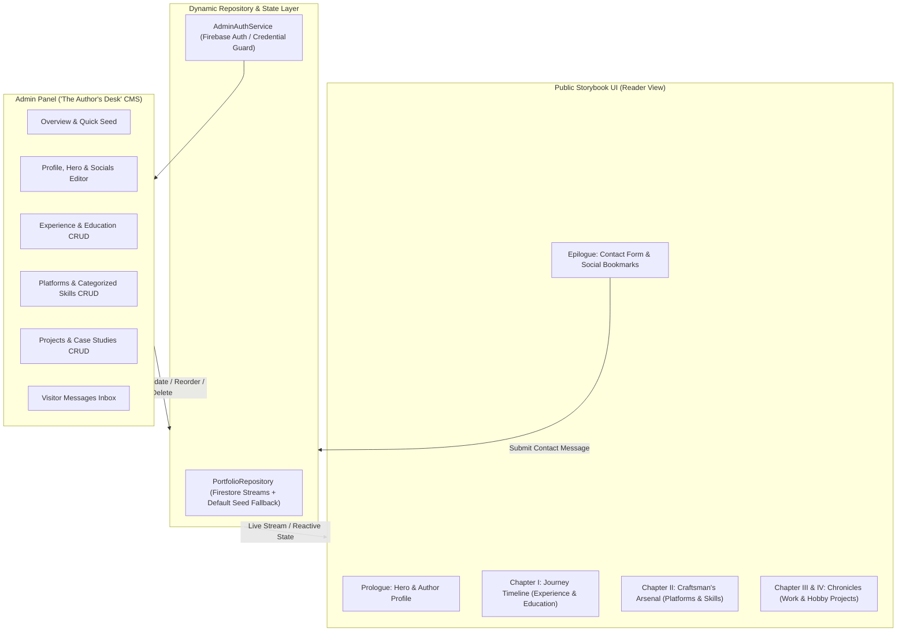

# Product Specification: Dynamic Portfolio Storybook & Admin CMS

**Project Name:** `my_porfolio` — Naing Paing Oo (Flutter Developer Portfolio)  
**Target SDK:** Flutter `3.44.0` (`D:\src\flutter3440`) / Dart `^3.5.3`  
**Backend & CMS Stack:** Firebase Core (`^3.6.0`), Firebase Auth (`^5.3.1`), Cloud Firestore (`^5.4.4`) — Project ID: `my-portfolio-b1b1c`  
**Document Purpose:** Complete product, architecture, and UI/UX specification for transforming the static portfolio into a **Modern Interactive Storybook** powered by a **Dynamic Admin Panel (CMS)**.

---

## 1. Current Project Review & Audit

### 1.1 Overview of Existing Implementation
The project is a single-page Flutter application (`lib/pages/home_page.dart`) with five sections stacked in a `SingleChildScrollView`:
1. **Hero / Main Section** (`MainDesktop` / `MainMobile` + `HeaderDesktop` / `HeaderMobile`)
2. **Skills Section ("What I can do")** (`SkillsDesktop` / `SkillsMobile`)
3. **Projects Section ("Work Projects" & "Hobby Projects")** (`ProjectSection` / `ProjectCardWidget`)
4. **About Me Section** (`AboutMeSection` / `AboutMe`)
5. **Contact Section ("Get In Touch") & Footer** (`ContactSection`, `Footer`, `BackToTopButton`)

All portfolio data is currently **hardcoded** inside Dart files (`lib/constants/skill_items.dart`, `lib/constants/sns_links.dart`, `lib/utils/project_utils.dart`, and inline `Text` widgets inside `lib/widgets/main_desktop.dart` and `lib/widgets/about_me.dart`), even though `firebase_core`, `firebase_auth`, `cloud_firestore`, and `android/app/google-services (1).json` (`my-portfolio-b1b1c`) were already added to the repository in preparation for dynamic data.

### 1.2 Technical Bugs & Code Issues Identified
| Location | Issue Found | Impact |
| :--- | :--- | :--- |
| `lib/widgets/about_me_section.dart` (Line 14) | `AboutMeSection` passes `key: navbarKeys[3]` to `super.key` **and** reassigns `key: key` to its inner `Container`. | Attaches the same `GlobalKey` to two widgets in the widget tree, causing duplicate `GlobalKey` errors and broken scroll targeting. |
| `lib/widgets/site_logo.dart` (Lines 10–13) | `GestureDetector(onTap: () {})` has an empty hardcoded callback and ignores the `onTap` field passed to `SiteLogo`. | Clicking the site logo never triggers navigation back to the top. |
| `lib/widgets/back_to_top_button.dart` & `home_page.dart` (Line 118) | `BackToTopButton` is placed as the last child inside the `SingleChildScrollView` `Column` instead of `Scaffold.floatingActionButton`. | The button does not float in the viewport; users only see it after scrolling all the way past the footer. |
| `lib/pages/home_page.dart` (Lines 50–61) | `HeaderDesktop` and `HeaderMobile` are rendered inside the scrollable `Column`. | The navigation bar immediately scrolls out of view instead of remaining sticky/pinned at the top. |
| `lib/widgets/about_me.dart` (Line 5) | `final bool isDesktop` is required by `AboutMe` but never referenced in `build()`, and all experiences/education are hardcoded inline strings. | No responsive layout adaptation and impossible to update dynamically without editing widget code. |
| `lib/widgets/contact_section.dart` (Line 30) & `custom_textfield.dart` | `ContactSection` wraps its container in a redundant nested `SingleChildScrollView`, uses raw `TextFormField` with `maxLines: 16`, ignores `CustomTextfield`, and only opens `mailto:` instead of saving messages to the Admin Panel. | Unstyled form fields and no centralized inbox for visitor inquiries. |
| `android/app/google-services (1).json` | Named `google-services (1).json` instead of `google-services.json`, and `Firebase.initializeApp()` is not yet configured in `lib/main.dart`. | Firebase services are not initialized at startup. |

---

## 2. Product Vision: Interactive Storybook + Dynamic Admin CMS

### 2.1 Dual-Experience Architecture
The application consists of two tightly integrated experiences sharing a unified reactive data layer:

1. **Public Reader Experience (The Developer Storybook):**
   - Presents the developer's portfolio as an interactive book (*"The Chronicle of Naing Paing Oo: Crafting Cross-Platform Worlds"*), organized into **Prologue, Chapters I–IV, and Epilogue**.
   - Streams live content dynamically from the database (with instant fallback to built-in seed data so the portfolio never renders blank offline or before initial setup).
   - Captures visitor inquiries directly from the **Epilogue Contact Form** into the Admin Inbox (while optionally still offering direct `mailto:` / `tel:` / copy-to-clipboard).

2. **Author's Desk (The Admin Panel CMS):**
   - A dedicated, authenticated dashboard (`/admin` route or accessible via a subtle **"Author Desk / Admin"** lock button in the footer/header).
   - Enables the portfolio owner to **Create, Read, Update, Reorder, Toggle Visibility, and Delete (CRUD)** every piece of content across all Storybook chapters in real time—without touching code or redeploying.
   - Includes a **"One-Click Seed / Reset from Default Data"** button so all current portfolio content (6 work projects, 3 hobby projects, 17 skills, 4 platforms, 3 experiences, B.C.Sc. education, profile & social links) can populate the database instantly.



---

## 3. Storybook Narrative Structure (Public Reader UI/UX)

### 3.1 Prologue — The Book Cover & Author Spread (Dynamic Hero)
- **Dynamic Fields Driven by Admin Panel:**
  - `greeting` (*"Hello, I'm"*), `fullName` (*"Naing Paing Oo"*), `roleTitle` (*"A Flutter Developer & Cross-Platform Craftsman"*), `tagline` / narrative intro bio, `availabilityBadge` (*"Available for Flutter & Cross-Platform Opportunities"*), `avatarUrl` (supports asset path `assets/my_passport.png` or remote image URL), `resumeUrl`, and dynamic `quickStats` (e.g., `4+ Platforms`, `9+ Projects`, `5 Distinctions`).
- **Visual Design:**
  - Two-page open-book editorial layout on desktop; stacked cover layout on mobile.
  - Framed author portrait with clamped responsive sizing (`220px–340px`), golden book-plate border, and floating tech emblems.

### 3.2 Chapter I — The Origin & Journey (Dynamic Experience & Education Timeline)
- **Narrative Header:** *"Chapter I · The Origin & Journey"*
- **Dynamic Content Driven by Admin Panel:**
  - **Work Experiences Collection:** Ordered by `sortOrder` / `startDate`. Each milestone displays `role`, `company`, `period`, `isCurrent` badge, `description`, and `highlights` (bullet points).
  - **Education Collection:** Displays `degree` (*"Bachelor of Computer Science (B.C.Sc.)"*), `institution` (*"University of Computer Studies, Thaton"*), `period` (*"December 2017 – January 2025"*), `honorsBadge` (*"Passed with 5 Distinctions & Qualified for M.C.Sc."*), and `coursework` tags.
- **Visual Design:**
  - Desktop uses `isDesktop: true` to display a two-column spread (Act I: Professional Timeline on the left page; Act II: Academic Scholar's Seal & Distinctions on the right page). Mobile stacks them cleanly with a connected vertical timeline spine.

### 3.3 Chapter II — The Craftsman's Arsenal (Dynamic Platforms & Categorized Skills)
- **Narrative Header:** *"Chapter II · The Craftsman's Arsenal"*
- **Dynamic Content Driven by Admin Panel:**
  - **Platforms (`platforms`):** Title, icon (asset or URL), description, and display order (`Android`, `Web`, `iOS`, `Desktop`).
  - **Skills (`skills`):** Name, icon (asset or URL), category (`Mobile & Core`, `Web & Frontend`, `Backend & Database`, `Design & DevOps`), proficiency level or badge, and visibility toggle.
- **Visual Design:**
  - 4 interactive Platform Realm cards at the top, followed by categorized Skill Domain cards and filterable tabs below.

### 3.4 Chapters III & IV — Chronicles of Creation & Side Quests (Dynamic Projects)
- **Narrative Headers:**
  - *"Chapter III · Chronicles of Creation (Work Projects)"*
  - *"Chapter IV · Side Quests & Experiments (Hobby Projects)"*
- **Dynamic Content Driven by Admin Panel:**
  - Unified `projects` collection with `projectType` (`'work'` or `'hobby'`), `category` (`'Mobile App'`, `'Web Platform'`, `'Desktop'`), `title`, `subtitle`, `detail` (full case-study story), `image` (asset path or network URL), `techStack` list (`['Flutter', 'Firestore']`), `androidLink`, `iosLink`, `webLink`, `githubLink`, `isFeatured`, and `sortOrder`.
- **Visual Design:**
  - Category filter pills (`All`, `Mobile Apps`, `Web Platforms`).
  - Editorial case-study cards (`320px–360px` wide) with chapter index badge (`No. 01`, `No. 02`), tech stack chips, hover elevation, and clean 3-line ellipsis truncation.
  - **Interactive Story Reader Modal:** Clicking any project opens a book-spread case study modal with banner artwork, tech tags, full story narrative, and live action buttons (GitHub, Web, Android, iOS).

### 3.5 Epilogue — Write the Next Chapter (Dynamic Contact & Message Submission)
- **Narrative Header:** *"Epilogue · Write the Next Chapter"*
- **Dynamic Content & Submission Flow:**
  - Contact details (`email`, `phone`, `location`) and Social Links (`github`, `linkedin`, `twitter`, `telegram`, `facebook`, `instagram`) are loaded dynamically from the `profile` document.
  - One-click **Copy to Clipboard** chips for email and phone with `SnackBar` confirmation.
  - When a visitor submits the Contact Form (`name`, `email`, `message`), the message is **saved directly to the `messages` collection** so the owner can read it inside the Admin Panel Inbox, with an optional fallback/secondary action to also launch `mailto:`.

---

## 4. Admin Panel ("The Author's Desk") Functional Specification

### 4.1 Hidden Access & Dynamic Daily Passcode Authentication
- **Hidden Admin Entry Point (5-Tap Version Trigger):**
  - The Admin Panel login button is **completely hidden** from all public navigation bars, drawers, and footers.
  - The footer (and mobile drawer footer) displays the application version number (`Version 1.0.0`).
  - **Secret Gesture:** Tapping `Version 1.0.0` **5 times** (within a 3-second window between taps) opens the hidden **Admin Panel Passcode** modal (`lib/widgets/admin_passcode_dialog.dart`).
- **Dynamic Daily Passcode Formula:**
  - The passcode is calculated dynamically from the current local date (`DD/MM/YYYY`):
    $$\text{Passcode} = (\text{day} + 7)(\text{month} + 7)(\text{year} + 7)$$
  - **Example:** When today is `23/11/2026`:
    - $\text{day} + 7 = 23 + 7 = 30$
    - $\text{month} + 7 = 11 + 7 = 18$
    - $\text{year} + 7 = 2026 + 7 = 2033$
    - Resulting Passcode: **`30182033`**
  - Entering the valid daily passcode unlocks **"The Author's Desk" (Admin CMS)** and navigates directly to `AdminPanelPage`. Firebase Email/Password authentication is also available inside the Admin Auth Gate.

### 4.2 Admin Panel Modules (6 Tabs / Sidebar Sections)

| Tab / Module | Capabilities & Form Fields |
| :--- | :--- |
| **1. Overview & Database Sync** | Summary counters (Total Work Projects, Hobby Projects, Skills, Timeline Milestones, Unread Messages). Includes **"Seed Default Portfolio Data"** button (populates Firestore with all existing portfolio data in one click) and **"Export JSON Backup"**. |
| **2. Prologue & Profile Editor** | Edit Full Name, Title/Role, Greeting, Bio/Story Lead, Availability Status toggle & text, Avatar Image (Asset path or Image URL with live preview), Resume Link, Quick Stats list, Contact Email, Phone, and Social Media URLs (`GitHub`, `LinkedIn`, `Twitter`, `Telegram`, `Facebook`, `Instagram`). |
| **3. Chapter I: Journey (Experience & Education)** | **Work Experience CRUD:** Add/Edit/Delete/Reorder experiences (`Role`, `Company`, `Period`, `Current Role` checkbox, `Description / Bullet Highlights`).<br>**Education CRUD:** Add/Edit/Delete education (`Degree`, `Institution`, `Period`, `Honors / Distinctions Badge`, `Coursework tags`). |
| **4. Chapter II: Arsenal (Platforms & Skills)** | **Platforms CRUD:** Manage the 4 platform realms (`Title`, `Subtitle/Description`, `Icon path or URL`, `Order`).<br>**Skills CRUD:** Add/Edit/Delete skills (`Skill Name`, `Category` dropdown: *Mobile & Core*, *Web & Frontend*, *Backend & Database*, *Design & DevOps*, `Icon path or URL`, `Order`). |
| **5. Chapters III & IV: Projects Manager** | Full CRUD for **Work Projects** and **Hobby Projects**:<br>- Switch between `Work Project` and `Hobby Project`<br>- `Title`, `Short Subtitle`, `Full Case-Study Story (Detail)`<br>- `Category` (*Mobile App*, *Web Platform*, *Full-Stack*)<br>- `Tech Stack Tags` (comma-separated or chip input, e.g., `Flutter, Firebase, Firestore`)<br>- `Cover Image` (supports existing `assets/projects/...` or any external `https://...` image URL with smart `AssetOrNetworkImage` renderer)<br>- `Links`: GitHub URL, Live Web URL, Android APK/Play Store URL, iOS URL<br>- `Display Order` & `Featured` toggle. |
| **6. Epilogue: Visitor Messages Inbox** | View messages submitted via the public Contact Form (`Sender Name`, `Sender Email`, `Message Body`, `Timestamp`, `Read/Unread` status). Actions: **Mark as Read**, **Reply via Email (`mailto:`)**, **Copy Email**, **Delete Message**. |

---

## 5. Data Architecture & Firestore Schema

### 5.1 Collections & Document Structure (`cloud_firestore`)

1. **`portfolio_config/profile` (Single Document)**
   ```json
   {
     "fullName": "Naing Paing Oo",
     "greeting": "Hello, I'm",
     "roleTitle": "A Flutter Developer",
     "storybookTitle": "Crafting Cross-Platform Worlds",
     "bio": "Passionate Flutter developer building fast, responsive Android, iOS, Web, and Desktop applications.",
     "availabilityText": "Available for Flutter & Cross-Platform Opportunities",
     "isAvailable": true,
     "avatarImage": "assets/my_passport.png",
     "email": "naingpaingoo@gmail.com",
     "phone": "+959790663667",
     "footerText": "Made by Min Naing Paing Oo with Flutter",
     "stats": [
       { "value": "4+", "label": "Platforms" },
       { "value": "9+", "label": "Projects Built" },
       { "value": "5", "label": "B.C.Sc. Distinctions" }
     ],
     "snsLinks": {
       "github": "https://www.github.com/minnaingpaingoo",
       "linkedin": "https://www.linkedin.com/in/naingpaingoo/",
       "twitter": "https://twitter.com/naingpaingoo",
       "facebook": "https://www.facebook.com/minnaingpaingoo",
       "instagram": "https://www.instagram.com/minnaingpaingoo/",
       "telegram": "https://t.me/minnaingpaingoo"
     }
   }
   ```

2. **`experiences` (Collection — ordered by `order`)**
   ```json
   {
     "id": "exp_1",
     "role": "Junior Flutter Developer",
     "company": "ITVisionHub",
     "period": "August 2024 – Present",
     "isCurrent": true,
     "highlights": [
       "Developing and maintaining cross-platform production Flutter applications."
     ],
     "order": 1
   }
   ```

3. **`educations` (Collection — ordered by `order`)**
   ```json
   {
     "id": "edu_1",
     "degree": "Bachelor of Computer Science (B.C.Sc.)",
     "institution": "University of Computer Studies, Thaton",
     "period": "December 2017 – January 2025",
     "honors": "Passed with 5 Distinctions and Qualified to Proceed to M.C.Sc.",
     "coursework": [
       "Mobile App Development",
       "Web Application Development",
       "Database Management Systems",
       "Software Engineering"
     ],
     "order": 1
   }
   ```

4. **`platforms` (Collection — ordered by `order`)**
   ```json
   {
     "id": "plat_1",
     "title": "Android Development",
     "subtitle": "Native-grade Android apps powered by Flutter, Dart & Kotlin.",
     "img": "assets/android_icon.png",
     "order": 1
   }
   ```

5. **`skills` (Collection — ordered by `order`)**
   ```json
   {
     "id": "skill_1",
     "title": "Flutter",
     "img": "assets/flutter.png",
     "category": "Mobile & Core",
     "order": 1
   }
   ```

6. **`projects` (Collection — ordered by `order`)**
   ```json
   {
     "id": "proj_1",
     "title": "UCSTT Voting App",
     "subtitle": "A digital voting app designed for UCSTT King & Queen selection events...",
     "detail": "A digital voting app designed for UCSTT King & Queen selection events...",
     "image": "assets/projects/ucstt_logo.png",
     "projectType": "work",
     "category": "Mobile App",
     "techStack": ["Flutter", "Dart", "Cloud Firestore"],
     "androidLink": null,
     "iosLink": null,
     "webLink": null,
     "githubLink": "https://github.com/minnaingpaingoo/ucstt_voting",
     "order": 1
   }
   ```

7. **`messages` (Collection — ordered by `createdAt` desc)**
   ```json
   {
     "id": "msg_1",
     "name": "Visitor Name",
     "email": "visitor@example.com",
     "message": "Hello, I'd love to discuss a Flutter project...",
     "createdAt": "2026-11-23T20:50:00Z",
     "isRead": false
   }
   ```

### 5.2 Smart Image Handling (`AssetOrNetworkImage` Widget)
Because initial projects and skills use bundled assets (`assets/...`) while newly added items from the Admin Panel may use web image URLs (`https://...`) or data URLs:
- Create a reusable `PortfolioImage` widget that automatically checks if `path.startsWith('http')` (renders `Image.network` with loading/error states) or `path.startsWith('assets/')` (renders `Image.asset` with graceful fallback icon).

### 5.3 Resilient Hybrid Repository Pattern
To ensure the app works seamlessly both when Firebase is live and when offline / prior to Firestore seeding:
- `PortfolioRepository` wraps Firestore streams and merges/falls back to default seed data (`defaultPortfolioData`).
- Any edits made in the Admin Panel update the active state immediately and persist to Cloud Firestore when connected.

---

## 6. UI/UX Design System ("Midnight Library" Storybook Theme)

### 6.1 Color Tokens (`lib/constants/colors.dart`)
| Token Name | Hex | Purpose |
| :--- | :--- | :--- |
| `scaffoldBg` (`canvasBg`) | `#12141D` | Deep Midnight ink outer background |
| `bgLight1` (`pageSurface`) | `#1A1D2A` | Storybook chapter page surface |
| `bgLight2` (`cardSurface`) | `#232738` | Elevated cards, timeline items, admin panels |
| `cardBorder` | `#333952` | Hairline 1px editorial border |
| `yellowPrimary` (`accentGold`) | `#F5A623` | Primary gold foil accent, chapter numbers, CTAs |
| `yellowSecondary` (`accentGoldSoft`) | `#FFC86B` | Hover glow, badges, active chapter indicator |
| `whitePrimary` | `#F4F5F8` | Primary headings & story copy |
| `whiteSecondary` | `#B4B9C8` | Subtitles, narrative body text |
| `hintDark` | `#787E91` | Captions, metadata, input placeholders |

### 6.2 Storybook Editorial Components
- **`StoryChapterHeader` Widget:** Displays chapter numeral (`CHAPTER I`, `CHAPTER II`, etc.), main title, italic epigraph subtitle, and an ornamental divider (`─── ✦ ───`).
- **Sticky Chapter Navigation Bar:** Pinned at the top of `HomePage` with active chapter highlighting as the user scrolls, plus a quick **"Author's Desk (Admin)"** button.
- **Floating Chapter Progress & Smart Back-to-Top FAB:** Shows reading progress and only reveals the back-to-top button after scrolling past `400px`.

---

## 7. Phased Implementation Roadmap (Completed)

### Phase 1: Dynamic Data Models, Seed Data & Repository Layer
- [x] Create unified data models in `lib/models/portfolio_models.dart` (`ProfileData`, `ExperienceItem`, `EducationItem`, `PlatformItem`, `SkillItem`, `ContactMessage`) and `lib/utils/project_utils.dart` (`ProjectUtils`).
- [x] Create `lib/services/portfolio_repository.dart` with reactive `ChangeNotifier` / Cloud Firestore sync, full CRUD methods, and built-in seed data preserving all current portfolio content.
- [x] Create `lib/widgets/portfolio_image.dart` to seamlessly render both `assets/...` and `https://...` image URLs added via the Admin Panel.

### Phase 2: Storybook Public UI/UX Redesign
- [x] Fix all identified bugs (`AboutMeSection` duplicate `GlobalKey`, `SiteLogo` callback, sticky header, scroll-aware floating `BackToTopButton`).
- [x] Build reusable `StoryChapterHeader` and ornamental chapter dividers in `lib/styles/style.dart`.
- [x] Redesign **Prologue (Hero)** (`MainDesktop` / `MainMobile`) with book-cover spread, availability pill, dynamic stats ribbon, and framed author portrait.
- [x] Redesign **Chapter I (About Me & Timeline)** (`AboutMeSection` / `AboutMe`) with interactive Work Experience timeline and Academic Scholar's Seal card.
- [x] Redesign **Chapter II (Skills & Platforms)** (`SkillsDesktop` / `SkillsMobile`) with 4 Platform Realm cards and categorized, filterable Skill domains.
- [x] Redesign **Chapters III & IV (Projects)** (`ProjectSection` / `ProjectCardWidget`) with category filters, tech stack badges, chapter numbering (`No. 01`...), and the **Interactive Story Reader Modal**.
- [x] Redesign **Epilogue (Contact & Footer)** (`ContactSection`, `CustomTextfield`, `Footer`) with postcard layout, copy-to-clipboard chips, direct message submission into the Admin Inbox, and an **"Author's Desk (Admin)"** entry link.

### Phase 3: Admin Panel ("The Author's Desk") Implementation
- [x] Build Authentication Gate in `lib/pages/admin_panel_page.dart` supporting both **Author Passkey (`admin1234`)** and **Firebase Auth Email/Password** sign-in/registration.
- [x] Build `lib/pages/admin_panel_page.dart` with a 6-section Storybook CMS Dashboard:
  - **Overview & 1-Click Cloud Firestore Seeder**
  - **Prologue & Profile Editor**
  - **Chapter I: Experience & Education CRUD Manager**
  - **Chapter II: Platforms & Categorized Skills CRUD Manager**
  - **Chapters III & IV: Work & Hobby Projects CRUD Manager**
  - **Epilogue: Visitor Messages Inbox**

### Phase 4: Verification & Polish
- [x] Update `web/index.html` metadata and configure `lib/firebase_options.dart` & `lib/main.dart` for `my-portfolio-b1b1c`.
- [x] Verify static analysis (`dart analyze` via `flutter3440`) — **0 issues found**.
